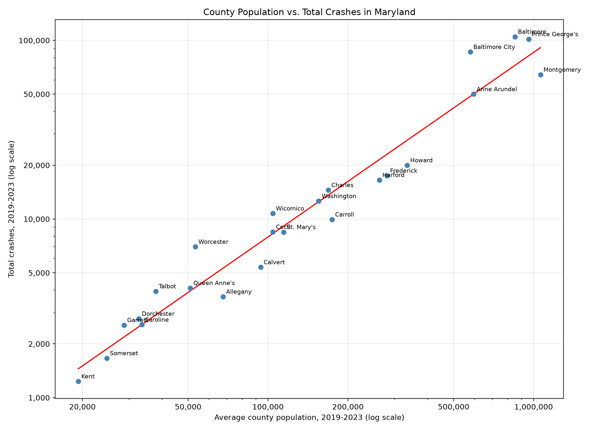

#Summary 
1. Data
The crash data came from the Maryland State Police Maryland Crash Data Download dashboard (analytics.mdsp.org), which compiles police crash reports submitted through the Automated Crash Reporting System (ACRS). We downloaded the Full Data export one year at a time (2019 to 2023), giving 539,842 crash reports in total. 
2. Cleaning
We stacked the five yearly files and grouped the reports by county, year and month, counting crashes by report type (property damage, injury, fatal). 
3. Population Data
County population came from U.S. Census Bureau estimates published by the Maryland Department of Planning. Because the two come from different estimate vintages, there may be a small discontinuity between 2019 and 2020.

#Method
To test whether larger counties have more crashes, we compared each jurisdiction's total crashes for 2019-2023 with its average population over the same years (n = 24). We used two measures of association:

    a. Pearson's correlation coefficient (r), which measures linear association.
    b. Spearman's rank correlation (rho), which measures whether counties rank similarly on population and crashes. It is less affected by a few very large counties.

#Results
County population vs. total crashes in Maryland

Figure 1. Average county population (2019-2023) against total crashes (2019-2023) for Maryland's 23 counties and Baltimore City

County population and total crashes were strongly and positively related:

Measure	        Value	p-value
Pearson r	    0.927	7.6e-11 (p < 0.001)
Spearman rho	0.974	1.2e-15 (p < 0.001)

Population accounts for roughly 86% of the differences in crash totals between counties

#Notes
* This is a correlation across 24 jurisdictions. It does not show that population causes crashes. 
* We used each county's average population over 2019-2023 because the crash total covers all five years.
* 2020 crash counts were about 18% lower than 2019, which reflects COVID-era driving changes.

#Sources
1. Maryland State Police, Maryland Crash Data Download dashboard, analytics.mdsp.org
2. U.S. Census Bureau, Population Division, via the Maryland Department of Planning: Intercensal Estimates of the Resident Population for Counties in Maryland, April 1, 2010 to April 1, 2020 and Table 1A, Total Resident Population for Maryland's Jurisdictions, April 1, 2020 to July 1, 2024